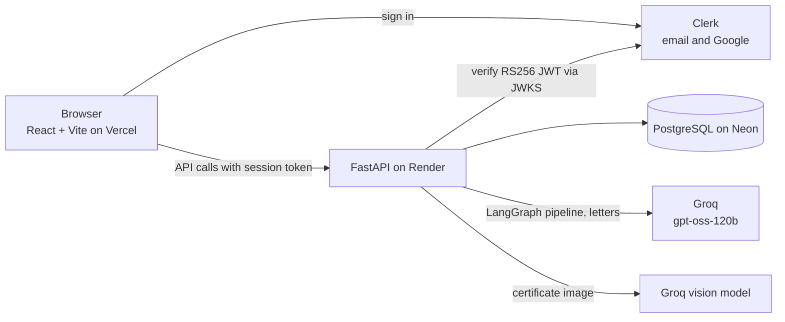
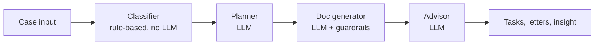

<h1 align="center">🕊️ GriefWallet</h1>

<h3 align="center">An AI assistant that turns the paperwork after a death into a clear recovery plan for Indian families</h3>

<p align="center"><i>Enter a few details. Get an ordered plan and draft letters. You review everything before anything is sent.</i></p>

<p align="center">
  
  
  
  
  
  
  
  
</p>

> **Live at [griefwallet.in](https://griefwallet.in).** This is an independent student project. It drafts documents and suggests next steps; it does not provide legal advice, and institutions' rules change. Always verify requirements with the institution before submitting anything.

---

## Why this exists

After a death, a family has to deal with many institutions at once, each with its own forms, documents and order of steps. One missing document (often the deceased's PAN) can stall several claims, and the people dealing with it are grieving. GriefWallet:

1. Collects a few facts about the deceased and the nominee.
2. Builds a task list per institution, with dependencies (what blocks what).
3. Drafts the formal letters, filled in with the case details.
4. Shows what to do next and what is waiting on something else.

## Features

- **Sign in with email or Google** (Clerk, production instance on a custom domain).
- **3-step case creation**, including an optional **death-certificate upload** that reads the name and date of death with a vision model and pre-fills the form. You review every value before saving; the image is processed in memory and not stored.
- **Recovery plan** from a 4-stage LangGraph pipeline: tasks per institution with priority, required documents, procedure steps, estimated duration and blockers.
- **Blocker detection:** missing PAN, missing Aadhaar or death certificate, disputed will, multiple nominees, legal-heir or succession certificate needs. Blocked tasks stay locked until their blocker is done.
- **Case page:** tasks grouped by institution, status updates, expandable required documents and procedure, AI "next steps" insight, document list, timeline and delete case.
- **On-demand letter drafting** (even for a blocked task, so it is ready when the blocker clears), with a "fill in before sending" list of the blanks left in each letter. Copy or download as text.
- **Privacy policy page** describing exactly what is collected and which services process it.

## Architecture



### The AI pipeline



| Stage | What it does |
|-------|--------------|
| Classifier | Deterministic rules turn the case into flags (`pan_missing`, `disputed_will`, `multiple_nominees`, ...) and loads the institution's knowledge file. No model involved, so it is testable and cheap. |
| Planner | The LLM builds the task list and dependencies, constrained to the knowledge base (required documents and durations come from it, not from the model's memory). |
| Doc generator | Drafts letters for high-priority, unblocked tasks. More below. |
| Advisor | Writes the "what to do next, what could go wrong, what can run in parallel" insight. |

Letters can also be generated on demand for any task that has a template, through `POST /ai/generate-document`.

## Making LLM output trustworthy

Live testing found real defects in generated letters. Each fix is enforced in code, not just in the prompt:

| Problem found | Fix |
|---------------|-----|
| The model reversed the relationship ("I, Arun, son of the late Abhishek" when Arun is the parent) | The introduction sentence is **built in code** from the case data and required verbatim. A kinship-word check catches other slips (father, mother, ...), retries once, and flags the letter if it still fails. |
| The model misspelled the deceased's name ("Abhashek") | Near-miss spellings of the real names are replaced with the exact ones. If the introduction is still missing, the letter is flagged for review. |
| Invented processing times ("15-20 working days") | The prompt forbids timelines that are not in the institution data, and the eval checks for them. |
| A PAN copy listed as an enclosure when the PAN is missing | The prompt receives the PAN state and uses a clearly marked placeholder instead. |
| Retired model names breaking the app | Model names are environment variables (`GROQ_MODEL`, `GROQ_VISION_MODEL`). |
| Vision output can be wrong | Extracted fields are validated (real date, not in the future, sane name), warnings are shown, and the user confirms every value. |

## Evaluation

Two scripts in `backend/`:

- **`run_eval.py`:** runs the full pipeline on three ground-truth families (clean case, multiple nominees with EPFO, missing PAN with a disputed will) and checks flags, task presence, blocking and injected tasks.
- **`run_letter_eval.py`:** generates letters across six nominee relationships and both PAN states (SBI and LIC) and scores each on: correct introduction, no kinship slip, no unsourced timeline, no deceased-PAN claim when missing, names spelled correctly, no `PLACEHOLDER` prefix, and a proper letter start. Failures print the offending line, and the full text is saved to `letter_eval_results.json` (keep that file out of git).

```bash
cd backend
python run_eval.py --verbose
python run_letter_eval.py --selftest          # checks the checkers, no API calls
python run_letter_eval.py --runs 1            # 24 letters
python run_letter_eval.py --runs 1 --only daughter,parent   # a subset
```

Groq's free tier has a daily token limit shared with the live app. The letter eval stops with an "INCOMPLETE" message if it hits the limit, instead of reporting a partial run as a pass.

## Tech stack

| Layer | Technology |
|-------|------------|
| Frontend | React 19, Vite, Tailwind CSS 3, React Router 7, Axios |
| Auth | Clerk (production instance, custom domain) |
| Backend | FastAPI, SQLAlchemy 2, Pydantic 2, Python 3.11 |
| Database | PostgreSQL on Neon (SQLite for local development) |
| AI | LangGraph, LangChain Groq, Groq `openai/gpt-oss-120b` (text), a Groq vision model (certificates) |
| Hosting | Vercel (frontend), Render (backend), Neon (database) |

## Project structure

```
GriefWallet/
├── AGENTS.md                  # Rules and conventions for AI coding agents
├── backend/
│   ├── main.py                # FastAPI app, CORS from FRONTEND_ORIGINS
│   ├── graph.py               # LangGraph pipeline
│   ├── prompts.py             # All LLM prompts (nominee_intro builds the relationship sentence)
│   ├── run_eval.py            # Pipeline ground-truth evaluator
│   ├── run_letter_eval.py     # Letter-quality evaluator
│   ├── agents/                # classifier, planner, doc_generator, advisor, certificate
│   ├── knowledge_base/        # sbi.json, hdfc.json, lic.json, epfo.json
│   ├── routers/               # auth, cases, tasks, ai, documents, timeline
│   ├── models/                # User, Case, Task, Document
│   └── db/                    # engine and session
└── frontend/
    └── src/
        ├── api.js             # Axios client; attaches the Clerk token
        ├── pages/             # Login, Dashboard, CreateCase, CaseDetail, Privacy, ...
        └── components/
```

## Local setup

Prerequisites: Python 3.11, Node 18+, a [Groq API key](https://console.groq.com) and a [Clerk](https://clerk.com) application.

```bash
# Backend
cd backend
python -m venv venv
venv\Scripts\activate          # Windows   (Mac/Linux: source venv/bin/activate)
pip install -r requirements.txt
cp .env.example .env           # then fill in the values
uvicorn main:app --reload      # http://localhost:8000, docs at /docs

# Frontend (new terminal)
cd frontend
npm install
cp .env.example .env           # then fill in the values
npm run dev                    # http://localhost:5173
```

### Environment variables (names only)

| Where | Variable | Purpose |
|-------|----------|---------|
| Backend | `GROQ_API_KEY` | Groq access |
| Backend | `GROQ_MODEL`, `GROQ_VISION_MODEL` | Optional model overrides |
| Backend | `DATABASE_URL` | Postgres URL (SQLite if unset) |
| Backend | `CLERK_ISSUER` | Clerk frontend API URL, e.g. `https://clerk.your-domain.com` |
| Backend | `CLERK_SECRET_KEY` | Server-side Clerk access (never in the frontend) |
| Backend | `CLERK_AUTHORIZED_PARTIES` | Allowed token origins |
| Backend | `FRONTEND_ORIGINS` | Allowed CORS origins |
| Frontend | `VITE_CLERK_PUBLISHABLE_KEY` | Clerk publishable key |
| Frontend | `VITE_API_URL` | Backend base URL |

## Deployment notes

- **Render (backend):** root directory `backend`, build `pip install -r requirements.txt`, start `uvicorn main:app --host 0.0.0.0 --port $PORT`. Set `PYTHON_VERSION=3.11.9` (newer versions fail to build `psycopg2-binary`).
- **Neon (database):** use the plain connection string as `DATABASE_URL`: no quotes, no `psql` prefix, ending in `?sslmode=require`.
- **Vercel (frontend):** `VITE_*` variables are baked in at build time, so redeploy after changing them.
- **Clerk:** a production instance needs a custom domain and its DNS records, and a Google OAuth client of your own.

## API

All routes except `/` and `/health` require a Clerk session token (`Authorization: Bearer ...`), and every case route checks that the case belongs to the caller.

| Method | Route | Description |
|--------|-------|-------------|
| GET | `/auth/me` | Current user |
| POST | `/cases/create` | Create a case |
| GET | `/cases` | List the caller's cases |
| GET | `/cases/dashboard-stats` | Dashboard numbers |
| GET | `/cases/{id}` | Case with tasks |
| DELETE | `/cases/{id}` | Delete a case and its data |
| GET | `/tasks/{case_id}` | Tasks for a case |
| PATCH | `/tasks/{task_id}` | Update a task's status |
| POST | `/ai/generate-checklist` | Run the full pipeline for a case |
| POST | `/ai/generate-insight` | Regenerate the AI insight |
| POST | `/ai/generate-document` | Draft one letter for a task |
| POST | `/ai/extract-certificate` | Read a death-certificate image (JPG, PNG, WEBP up to 8 MB; not stored) |
| GET | `/documents/{case_id}` | Letters for a case |
| GET | `/timeline/{case_id}` | Case events and progress |
| GET | `/health` | Health check |

## Security and privacy

- Session tokens are verified on the server with Clerk's public keys (RS256), including issuer, expiry and authorized origin.
- Secrets (`CLERK_SECRET_KEY`, `GROQ_API_KEY`, `DATABASE_URL`) live only in hosting dashboards, never in the repository or the frontend.
- CORS allows exact origins only.
- Certificate images are processed in memory and sent to the AI provider only to read them. See the in-app [privacy policy](https://griefwallet.in/privacy).

## Known limitations

- The Documents and Timeline top-level pages are basic; the full versions live inside each case page today.
- Access is per-user only. There are no roles, sharing or institution accounts yet.
- Dedicated knowledge files exist for SBI, HDFC, LIC and EPFO. NPS and mutual funds use a generic fallback.
- Certificate upload accepts images only (no PDF).
- The timeline is derived from last-updated times, not a full event history.
- Tables are created on startup; there are no database migrations yet.
- Groq's free tier has a daily token limit that the app and the evals share.

## Roadmap

- Case event log for a real timeline, and letter status (draft, ready, sent) with in-page fill-in of blanks.
- More institutions (ICICI, PNB, Post Office, more insurers) and Hindi or regional-language letters.
- Reminders and deadline tracking.
- Case chat grounded in the case data and knowledge base.
- Extraction from more documents (Aadhaar, passbook, policy copy), and PDF certificates.
- Case sharing with roles, PDF export of a full case pack, Alembic migrations.
- Tracing for LLM calls and automated tests in CI.

## Contributing

1. Fork the repository and create a branch (`git checkout -b feat/your-feature`).
2. Read `AGENTS.md` for project rules.
3. Commit, push and open a pull request.

## License

MIT. Add a `LICENSE` file at the repository root to match this.

## Author

Built by **Shrey Kumar** ([GitHub](https://github.com/shrey9741)).

*GriefWallet is dedicated to every family working through loss. May it make one difficult thing a little easier.*
